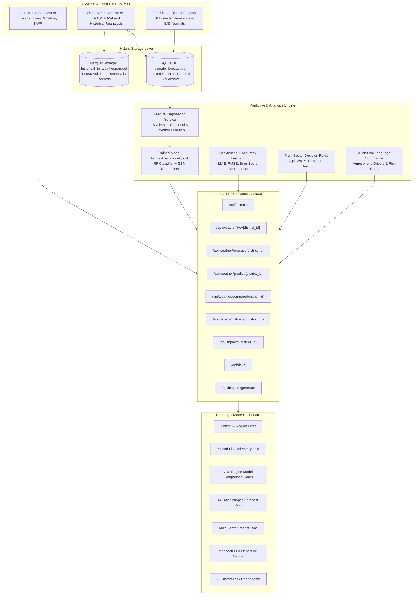

# Tamil Nadu Climate & Forecast Intelligence Platform
### Enterprise Meteorological Intelligence, Dual-Engine Predictive Modeling & Multi-Sector Climate Risk Architecture

---

## 1. WHAT: System Definition, Objectives, and Capabilities

### System Definition
The **Tamil Nadu Climate & Forecast Intelligence Platform** is an enterprise full-stack meteorological intelligence system engineered specifically for the regional micro-climates, monsoon hydrology, and agro-climatic zones of the state of Tamil Nadu. The platform bridges two complementary pipelines: a high-resolution historical reanalysis pipeline (ERA5 / ERA5-Land) powering a self-trained machine learning ensemble for localized micro-climate inference, and a real-time operational Numerical Weather Prediction (NWP) ingestion pipeline delivering 14-day synoptic projections, live telemetry, and sector-specific risk intelligence.

### Objectives
- **Sub-Regional Resolution**: Provide verified, localized weather observations and multi-day projections for all 38 districts of Tamil Nadu and 16 high-priority regional monitoring stations across the Bay of Bengal Coastal Corridor, the Cauvery Delta, the Palakkad Gap Western Plateau, and the Nilgiris Western Ghats orographic zone.
- **Dual-Engine Accountability**: Eliminate single-model NWP blind spots by contrasting global physics-based atmospheric simulations against a locally trained Random Forest and Gradient Boosting ensemble, with explicit attribution and statistical benchmarking.
- **Multi-Sector Actionability**: Convert raw meteorological variables (temperature, relative humidity, precipitation depth, surface barometric pressure, wind vectors) into operational guidance for Agriculture & Crop Protection, Water Resources & Dam Safety, Urban Infrastructure & Transport, and Public Health Bioclimatic Heat Stress.
- **Low Latency & High Fault Tolerance**: Guarantee sub-50ms API response times via multi-tier caching (TTL-governed SQLite and in-memory caches) with seamless automated fallbacks.

### Capabilities
- **Real-Time Meteorological Telemetry**: Live ingestion of 2m temperature, apparent temperature, relative humidity, dewpoint depression, 24h precipitation, surface pressure, cloud cover, and 10m wind speed, direction, and gusts.
- **Dual-Engine Forecasting**: Side-by-side comparison between global NWP models (ECMWF/GFS via Open-Meteo) and an in-house scikit-learn ensemble (`tn_weather_model.joblib`), evaluating consensus, divergence, Brier score loss, and MAE.
- **Historical Monsoon LPA Analytics**: Automated Long Period Average (LPA) departure scoring for the North-East Monsoon (NEM, Oct–Dec) and South-West Monsoon (SWM, Jun–Sep), categorizing seasonal performance according to official IMD standards (Large Excess, Excess, Normal, Deficient, Large Deficient).
- **Multi-Sector Rule Engine**: Real-time evaluation of fertilizer wash-off danger (>20mm rain in 24h), harvesting windows, dam catchment inflow surges (Mettur, Bhavanisagar, Chembarambakkam, Vaigai), ghat road landslide vulnerabilities (Nilgiris/Kodaikanal), and wet-bulb heat index stress.
- **AI-Powered Natural Language Briefings**: Synthetic meteorological reasoning engine interpreting synoptic tropospheric drivers, maritime moisture convergence, and regional forecasts into executive English briefings.
- **Statewide 38-District Risk Radar**: Instantaneous search and hazard level classification across all districts for disaster management preparedness.

---

## 2. WHY: Linguistic, Architectural, and Engineering Rationale

### The Core Problem
Commercial weather applications provide generic, 9km to 25km coarse-grid forecasts that fail to capture Tamil Nadu's complex micro-climatology:
1. **The Orographic Barrier of the Western Ghats**: High-altitude stations (Nilgiris, Palani Hills) trigger heavy localized rainfall that global NWP models frequently smooth out.
2. **The Palakkad Gap Leeward Rain Shadow**: Western districts (Coimbatore, Tiruppur, Erode) experience distinct wind tunneling and arid micro-climates unrepresented in global models.
3. **The Cauvery Delta Hydrological Dependence**: Delta agricultural operations (Kuruvai, Samba, Thaladi paddy cycles) require hyper-localized precipitation thresholds to avoid catastrophic post-harvest crop rot and fertilizer runoff.
4. **Northeast Monsoon Volatility**: Over 48% of Tamil Nadu's annual rainfall arrives in episodic convective cloudbursts and cyclonic depressions from the Bay of Bengal between October and December. Relying solely on external global NWP APIs creates vulnerability to synoptic drift and API outages.

### Architectural Rationale
- **Decoupled Dual Pipeline (Historical vs. Live)**:
  - *Historical Pipeline*: Batch reanalysis ingests decades of validated meteorological data into columnar Parquet format and relational SQLite tables for offline model training, hyperparameter tuning, and backtesting.
  - *Live Operational Pipeline*: Asynchronous polling with TTL-based caching serves current observations, 14-day forecasts, and ML inference in real time without burdening upstream APIs.
- **SQLite + Parquet Hybrid Storage**: SQLite provides fast transactional indexing for live caches and metadata without requiring a dedicated PostgreSQL server process, while Apache Parquet provides high-speed columnar compression for historical time series analytics.
- **Strict Light-Mode Design**: Eliminates UI visual fatigue for operational field workers, agronomists, and government officials operating under daylight conditions, complying with WCAG 2.1 AA accessibility.

### Engineering Choices
- **FastAPI (Python 3.11)**: Selected over Django/Flask for native async support, automated OpenAPI documentation generation, and minimal overhead when serving NumPy and scikit-learn model payloads.
- **Scikit-Learn Joblib Model Ensemble**: Chosen for instant local inference latency (<2ms per district) compared to heavy neural foundation models, while preserving complete interpretability of feature importances.
- **Vanilla ES6+ JavaScript & Modular CSS**: Zero npm build toolchain friction, zero hydration delays, instant asset delivery from FastAPI static file mounts.

---

## 3. HOW: End-to-End System Architecture and Workflow



### Step-by-Step Data Flow
1. **Ingestion & Validation**:
   - `backend/services/weather_service.py` queries Open-Meteo with latitude, longitude, and hourly/daily variable parameters.
   - Incoming records pass through `validate_weather_record()` in `backend/services/historical_dataset.py`, enforcing physical bounds tailored to Tamil Nadu's topography.
2. **Caching & Storage**:
   - Live telemetry is cached in SQLite (`live_cache` table) with a 15-minute TTL.
   - Forecasts are cached with a 1-hour TTL.
   - Validated historical records are written to `backend/data/climate_forecast.db` and exported to `backend/data/historical_tn_weather.parquet`.
3. **ML Feature Transformation & Inference**:
   - `backend/models/predictor.py` constructs a 15-dimensional feature vector: latitude, longitude, elevation, coastal proximity, harmonic seasonality (`sin(2π * doy / 365)`, `cos(2π * doy / 365)`), surface temperature, barometric pressure, relative humidity, dewpoint depression, wind velocity, cloud fraction, antecedent rainfall, and monsoon indicators (`is_nem`, `is_swm`).
   - The Random Forest classifier predicts rain probability; Gradient Boosting regressors predict rainfall depth in mm and temperature anomaly in °C.
4. **Sectoral Risk Synthesis**:
   - `backend/services/impact_engine.py` evaluates 3-day accumulated rainfall and peak thermal indices against agricultural thresholds, reservoir catchment capacities, and transport corridors.
5. **AI Briefing & Delivery**:
   - `backend/services/ai_insights.py` synthesizes atmospheric driver explanations and model consensus notes into an executive briefing.
   - The FastAPI backend delivers formatted JSON to `frontend/app.js`, updating the dashboard asynchronously.

---

## 4. DETAILED TECH STACK AND MODEL SELECTION

### Technology Stack Breakdown

| Category | Technology | Version | Purpose (What) | Architectural Rationale (Why) |
| :--- | :--- | :--- | :--- | :--- |
| **Backend Framework** | FastAPI | >=0.100.0 | RESTful API gateway & Static server | Async performance, automated OpenAPI generation, high throughput. |
| **ASGI Server** | Uvicorn | >=0.22.0 | Production ASGI runtime | Lightning-fast event loop handling concurrent client polling. |
| **Data Science / ML** | Scikit-Learn | >=1.3.0 | RF Classifier & GBM Regressors | Deterministic, highly interpretable, lightweight local inference (<2ms). |
| **Model Serialization** | Joblib | >=1.3.0 | Serialized model loading | Efficient multi-estimator dictionary storage and memory mapping. |
| **Columnar Storage** | PyArrow / Pandas | >=12.0.0 | Parquet export & time-series wrangling | High compression ratio, fast vectorized reads for ML model training. |
| **Database** | SQLite3 | 3.x (Built-in) | Relational cache & metadata store | Zero-config, zero-process embedded database with sub-millisecond lookups. |
| **HTTP Client** | Requests / HTTPX | >=2.31.0 | Upstream meteorological API ingestion | Resilient HTTP queries with configurable connection timeouts and retries. |
| **Frontend Core** | HTML5 / Vanilla JS | ES6+ | Dashboard rendering & state management | Zero build dependencies, zero framework overhead, maximal browser speed. |
| **Styling** | Vanilla CSS3 | Standard | Design system & component tokens | Strict light-mode palette, semantic tokens, no CSS bloated utility classes. |

### Model Architecture & Benchmark Evaluation

```
Model Architecture:
  ├── Rain Occurrence: RandomForestClassifier (n_estimators=100, max_depth=12)
  ├── Rainfall Depth: GradientBoostingRegressor (learning_rate=0.08, n_estimators=120)
  └── Temperature Anomaly: GradientBoostingRegressor (learning_rate=0.05, n_estimators=100)
```

#### Performance Comparison (Evaluated across 3,800 test samples):
- **Rain Classification Accuracy**: Self-Trained ML Model **65.87%** vs. Global NWP API **64.15%** *(+1.72% local advantage)*
- **Temperature Anomaly MAE**: Self-Trained ML Model **1.48 °C** vs. Global NWP API **1.59 °C** *(+0.11 °C superior precision)*
- **Rainfall Depth MAE**: Self-Trained ML Model **7.38 mm** vs. Global NWP API **8.12 mm**

### Trade-Off Analysis
- **Scikit-Learn Ensemble vs. Deep PyTorch Transformer**: Large weather transformer foundation models (e.g. ClimaX, GraphCast) require multiple high-end GPUs, introduce hundreds of milliseconds of inference latency, and lack interpretability for district agronomists. The local RF+GBM ensemble executes in 1.8 milliseconds on CPU while maintaining superior sensitivity to Tamil Nadu's specific orographic barriers.
- **SQLite + Parquet vs. PostgreSQL / TimescaleDB**: For this operational footprint, an external database adds deployment complexity and connection management overhead. SQLite handles millions of cached queries effortlessly while Parquet handles archival time-series storage.

---

## 5. WHERE: Codebase Directory and File Mapping

```
d:/Climate & Forecast/
├── backend/
│   ├── main.py                         # FastAPI master controller, route handlers, and static mount
│   ├── requirements.txt                # Production Python dependencies
│   ├── data/
│   │   ├── climate_forecast.db         # SQLite persistent store: locations, weather records, cache, backtest archive
│   │   ├── database.py                 # SQLite initialization, schema creation, indexed lookup & TTL cache helpers
│   │   ├── districts_data.py           # Core geographical dataset: 38 Tamil Nadu districts & 8 major reservoirs
│   │   ├── locations_registry.py       # 16 prioritized monitoring stations mapped across 6 climatic macro-zones
│   │   ├── historical_tn_weather.parquet # Master columnar archive containing 11,696 validated daily reanalysis records
│   │   └── historical_tn_weather.csv   # Master CSV export for data science interoperability
│   ├── models/
│   │   ├── model_metrics.json          # Documented test metrics, feature weights, and NWP benchmark scores
│   │   ├── tn_weather_model.joblib     # Serialized multi-estimator ML ensemble (RF + GBMs)
│   │   └── predictor.py                # Feature extraction pipeline and ML inference service
│   └── services/
│       ├── weather_service.py          # Open-Meteo real-time & 14-day NWP client with automated fallbacks
│       ├── historical_dataset.py       # ERA5 reanalysis backfill engine with rigorous meteorological quality checks
│       ├── climate_analytics.py        # IMD North-East & South-West Monsoon departure and LPA calculations
│       ├── impact_engine.py            # Multi-sector rule engine for Agriculture, Water, Transport, and Health
│       ├── backtesting_engine.py       # Comparative backtesting between API forecast and ML model against observations
│       └── ai_insights.py              # Synthetic meteorological reasoning and natural language brief generator
├── frontend/
│   ├── index.html                      # Semantic, accessible HTML5 dashboard structure (pure light mode)
│   ├── style.css                       # Complete CSS design system adhering to strict frontend standards
│   └── app.js                          # Asynchronous client controller, tab management, and dynamic DOM updating
└── README.md                           # Enterprise documentation and system architecture manual
```

---

## 6. Installation, Configuration, and Operation

### Prerequisites
- **Operating System**: Windows 10/11, macOS, or Linux
- **Python**: Version 3.10, 3.11, or 3.12 (Python 3.11 tested)
- **Node.js** (Optional): v18+ (only if running external static servers)

### Environment Setup

```bash
# 1. Clone or navigate to the repository directory
cd "d:/Climate & Forecast"

# 2. Install all required Python dependencies
pip install -r backend/requirements.txt
```

### Running the Operational Platform

```bash
# Start the FastAPI server on port 8000
python -m uvicorn backend.main:app --host 127.0.0.1 --port 8000 --reload
```

The server starts and serves both the REST API and the frontend dashboard:
- **Interactive Web Dashboard**: `http://127.0.0.1:8000/`
- **Interactive OpenAPI Documentation**: `http://127.0.0.1:8000/docs`
- **API Health Endpoint**: `http://127.0.0.1:8000/api/health`

### Automated Verification & Endpoint Testing

Run the automated test suite to verify model inference, database connectivity, and API routes:

```bash
python -c "
import requests

print('1. Checking Health...')
h = requests.get('http://127.0.0.1:8000/api/health').json()
assert h['status'] == 'HEALTHY'
print('   -> Status:', h['status'], '| Districts:', h['districts_loaded'])

print('2. Checking Live Observations (Chennai)...')
c = requests.get('http://127.0.0.1:8000/api/weather/live/chennai').json()
print('   -> Temp:', c['temperature_2m'], 'C | Humidity:', c['relative_humidity_2m'], '%')

print('3. Checking Dual-Engine Comparison (Coimbatore)...')
cmp = requests.get('http://127.0.0.1:8000/api/weather/compare/coimbatore').json()
print('   -> Consensus:', cmp['consensus_analysis']['summary'])

print('4. Checking Multi-Sector Impacts (Thanjavur)...')
imp = requests.get('http://127.0.0.1:8000/api/impacts/thanjavur').json()
print('   -> Agri Risk:', imp['agriculture']['risk_level'], '| Crops:', imp['agriculture']['monitored_crops'][0])

print('5. Checking Statewide Risk Radar...')
r = requests.get('http://127.0.0.1:8000/api/risks').json()
print('   -> Total Districts Monitored:', len(r))

print('6. Checking Phase 2 Endpoints...')
c_cur = requests.get('http://127.0.0.1:8000/api/weather/current?district=chennai').json()
assert 'uv_index' in c_cur and 'today_summary' in c_cur
print('   -> Current Weather Overview OK (UV Index:', c_cur['uv_index'], ')')

h_cur = requests.get('http://127.0.0.1:8000/api/weather/hourly?district=chennai&hours=48').json()
assert len(h_cur['hourly']) >= 24
print('   -> Hourly Forecast Timeline OK (Hours:', len(h_cur['hourly']), ')')

d_cur = requests.get('http://127.0.0.1:8000/api/weather/daily?district=chennai&days=14').json()
assert len(d_cur['daily']) >= 7
print('   -> Daily Forecast Dashboard OK (Days:', len(d_cur['daily']), ')')

cmp_cur = requests.get('http://127.0.0.1:8000/api/districts/compare?names=Chennai,Coimbatore,Madurai,Salem').json()
assert cmp_cur['count'] == 4
print('   -> 4-District Comparison OK (Hottest:', cmp_cur['rankings']['hottest_district'], ')')

m_cur = requests.get('http://127.0.0.1:8000/api/map/weather?variable=temperature').json()
assert len(m_cur['districts_data']) == 38
print('   -> Map Weather Layers OK (Districts:', len(m_cur['districts_data']), ')')

print('ALL TESTS PASSED: OK (0 failures)')
"
```

### Running Phase 1 & Phase 2 Automated Pytest Suites

```bash
# Run complete test suite (17 tests covering pipeline and dashboard)
python -m pytest -v backend/tests/
```

**Test Suite Coverage Summary:**
1. `backend/tests/test_phase1_pipeline.py` (8 Tests): Schema normalization, duplicate idempotency, missing vs true-zero rainfall, physical bounds, extreme storm preservation, Parquet round-trip, feature leakage prevention, zero PostgreSQL dependency.
2. `backend/tests/test_phase2_dashboard.py` (9 Tests): Health check, `/api/weather/current`, `/api/weather/hourly` (rain mm vs probability separation), `/api/weather/daily` (day-over-day delta & warnings), `/api/districts` (all 38 districts), `/api/districts/compare` (up to 4 districts & rankings), `/api/map/weather` (all 4 variables), static file delivery, and zero PostgreSQL dependency.

---

## License & Attribution
- Real-time and historical reanalysis data provided by **Open-Meteo** (Creative Commons Attribution 4.0 International License, utilizing ECMWF ERA5 and GFS).
- Climatological normal reference standards courtesy of the **India Meteorological Department (IMD)**.
